# Development Roadmap — LNCT Connect 2.0

```mermaid
graph TD
    P0[Phase 0: Audit & Tooling Verification] -->|Completed| P1[Phase 1: Theme & Shared UI Redesign]
    P1 -->|Completed| P2[Phase 2: Custom Cursor & Interactions]
    P2 -->|Completed| P3[Phase 3: Interactive 3D Campus Network]
    P3 -->|Completed| P4[Phase 4: Scroll-Driven 3D Transformations]
    P4 -->|Completed| P5[Phase 5: Holistic Page Integration]
    P5 -->|Completed| P6[Phase 6: Performance, Accessibility & QA]
    P6 -->|Completed| P7[Phase 7: Visual & Interaction Refinements]
    P7 -->|Completed| P8[Phase 8: Backend Foundation & Supabase Setup]
    P8 -->|Completed| P9[Phase 9: Auth, Sessions & Verification]
    P9 -->|Completed| P10[Phase 10: Profiles, Skills & Connections]
    P10 -->|Completed| P11[Phase 11: Community Feed & Posts]
    P11 -->|Completed| P12[Phase 12: Projects & Opportunities]
    P12 -->|Completed| P13[Phase 13: Mentorship Workflows]
    P13 -->|Completed| P14[Phase 14: Messaging & Realtime Notifications]
    P14 -->|Completed| P15[Phase 15: Admin Moderation & Security Hardening]
    P15 --> P16[Phase 16: Database Security & RLS Hardening]
    P16 --> P17[Phase 17: Authentication & Verification Integrity]
    P17 --> P18[Phase 18: Supabase Integration & Data Flow Correctness]
    P18 --> P19[Phase 19: Functionality, Admin & Realtime Polish]
    P19 --> P20[Phase 20: Performance, Tooling & Script Hygiene]
    P20 --> P21[Phase 21: Final Verification & End-to-End Validation]
```

## Phase Overview

### [x] Phase 0: Codebase Audit & Tooling Verification
- **Goal**: Full dependency inspection, route mapping, and build tool verification.
- **Status**: Completed.

### [x] Phase 1: Theme & Shared UI Redesign
- **Goal**: Activate the white, black, and burnt-orange color system across CSS tokens, shared UI components (`ui.tsx`, `layout.tsx`, `cards.tsx`), and views.
- **Status**: Completed.

### [x] Phase 2: Custom Cursor & Micro-Interactions
- **Goal**: Implement custom cursor trailing physics, magnetic button dynamics, top scroll progress, and subtle 3D card tilt.
- **Status**: Completed.

### [x] Phase 3: Interactive 3D Campus Network
- **Goal**: Upgrade Three.js / React Three Fiber network scene to represent students, skills, projects, alumni, mentors, and opportunities using the brand palette.
- **Status**: Completed.
- **Key Deliverables Achieved**:
  1. Rebuilt node architecture in [`src/components/NetworkScene.tsx`](file:///c:/Users/admin/OneDrive/Documents/lnct-connect-frontend-mvp/src/components/NetworkScene.tsx) with 6 distinct campus categories: Students (`#E76F35`), Alumni (`#20211F`), Mentors (`#C25828`), Projects (`#4A3B32`), Skills (`#737068`), and Opportunities (`#D97706`).
  2. Eliminated legacy blue point lights; deployed warm alabaster ambient light (`#FAF9F6`) and burnt-orange key light (`#E76F35`).
  3. Integrated `@react-three/drei` `<Html>` spatial micro-chips projecting labels directly near key anchor nodes in 3D space.
  4. Added raycasted hover interaction with scale expansion and highlight transitions.
  5. Placed an interactive Spatial Campus Graph legend in the hero section of [`LandingPage.tsx`](file:///c:/Users/admin/OneDrive/Documents/lnct-connect-frontend-mvp/src/pages/LandingPage.tsx).
  6. Verified production build cleanly (`tsc -b && vite build` in 1.71s).

### [x] Phase 4: Scroll-Driven 3D Transformations
- **Goal**: Orchestrate scroll-driven spatial transformations where 3D nodes transition into floating student profiles, project cards, opportunities, and mentorship.
- **Status**: Completed.
- **Key Deliverables Achieved**:
  1. Implemented 5 smoothstep waypoints in `CameraController` across Hero, Students, Projects, Opportunities, and Mentorship sections.
  2. Category node morphing & active stage scaling in `NetworkNodes`, pushing active category clusters into the camera plane as user scrolls.
  3. Continuous inertial damping (`0.08` lerp) inside `useFrame`, eliminating React state re-rendering overhead on scroll for butter-smooth 60fps/120fps motion.
  4. Created `SpatialCard` in [`src/components/Interactive.tsx`](file:///c:/Users/admin/OneDrive/Documents/lnct-connect-frontend-mvp/src/components/Interactive.tsx) with 3D perspective emergence (`transformPerspective: 1200`), direction-based rotation, spatial z-offset, and integration with `TiltCard`.
  5. Refactored [`src/pages/LandingPage.tsx`](file:///c:/Users/admin/OneDrive/Documents/lnct-connect-frontend-mvp/src/pages/LandingPage.tsx) so `NetworkCanvas` runs persistently as a fixed background, with translucent section backdrops allowing glowing connection lines and nodes to shine through behind the emergent cards.
  6. Verified production build cleanly (`tsc -b && vite build` in 2.07s).

### [x] Phase 5: Holistic Page Integration
- **Goal**: Deep editorial polish and spatial composition integration across all interior views (Home, People, Projects, Opportunities, Mentorship, Messages, Settings, Auth).
- **Status**: Completed.
- **Key Deliverables Achieved**:
  1. Updated [`src/components/layout.tsx`](file:///c:/Users/admin/OneDrive/Documents/lnct-connect-frontend-mvp/src/components/layout.tsx) with frosted-glass sticky header (`--color-header-bg`), expanded 5-destination mobile dock, and comprehensive editorial `Footer`.
  2. Integrated `MagneticButton` into primary CTAs across [`AuthPages.tsx`](file:///c:/Users/admin/OneDrive/Documents/lnct-connect-frontend-mvp/src/pages/AuthPages.tsx), [`HomePage.tsx`](file:///c:/Users/admin/OneDrive/Documents/lnct-connect-frontend-mvp/src/pages/HomePage.tsx), [`ProfilePage.tsx`](file:///c:/Users/admin/OneDrive/Documents/lnct-connect-frontend-mvp/src/pages/ProfilePage.tsx), [`ProjectsPage.tsx`](file:///c:/Users/admin/OneDrive/Documents/lnct-connect-frontend-mvp/src/pages/ProjectsPage.tsx), [`MentorshipPage.tsx`](file:///c:/Users/admin/OneDrive/Documents/lnct-connect-frontend-mvp/src/pages/MentorshipPage.tsx), and [`SettingsPage.tsx`](file:///c:/Users/admin/OneDrive/Documents/lnct-connect-frontend-mvp/src/pages/SettingsPage.tsx).
  3. Verified `TiltCard` micro-interaction across student cards, project cards, opportunities, and mentor cards throughout all views.
  4. Tested light and dark theme variable synchronization in [`src/index.css`](file:///c:/Users/admin/OneDrive/Documents/lnct-connect-frontend-mvp/src/index.css).
  5. Verified production build cleanly (`tsc -b && vite build` in 2.41s).

### [x] Phase 6: Performance, Accessibility & Final Validation
- **Goal**: Verify 60fps scrolling, WCAG AA compliance, reduced-motion fallbacks, mobile optimizations, and final QA.
- **Status**: Completed.
- **Key Deliverables Achieved**:
  1. Performance & Bundle Optimization: Three.js dynamically code-split into its own bundle (`NetworkScene-b6hx_w20.js`), instanced mesh (`InstancedMesh`) for 60 nodes, zero-rerender continuous damping frame loop, clean production build in 2.13s.
  2. Contrast & WCAG Compliance: Exceeded WCAG AA across all theme tokens (`15.8:1` ink, `8.3:1` secondary, `14.2:1` inverted dark panel, `16.2:1` dark mode ink), 2px focus rings, semantic landmark elements.
  3. Accessibility & Motion: Complete `prefers-reduced-motion` and `pointer: fine` guards on custom cursor, 3D tilts, and magnetic buttons.
  4. Cross-Device Responsiveness: Mobile hamburger menu with drawer, 5-destination thumb dock, fluid clamp typography, horizontal touch scrolling, and 360px+ to ultra-wide adaptability.

### [x] Phase 7: Visual & Interaction Refinements
- **Goal**: Implement Apple-inspired liquid button tactile physics across primary CTAs and deep-choreograph a cinematic scroll-driven 3D campus constellation across `Students ↔ Skills ↔ Projects ↔ Alumni ↔ Opportunities`.
- **Status**: Completed & Verified.
- **Key Deliverables Achieved**:
  1. Apple-Inspired Liquid Glass Buttons: Reusable `LiquidButton` component and enhanced `Button` with dynamic cursor-tracking specular spotlight (`--liquid-x`, `--liquid-y`), 1px refractive bevel rim, tactile spring press physics (`active:scale-[0.97]`), burnt-orange, dark charcoal, and warm alabaster variants.
  2. Full Button Accessibility & Forms: Maintained native `<button>` semantics, form submissions (`type="submit"`), disabled states, 2px offset `:focus-visible` rings, and mobile touch feedback without sticky hover artifacts.
  3. Cinematic Depth Constellation: 6-waypoint camera trajectory traversing forward through depth ($Z$: $7.4 \to 5.4 \to 4.8 \to 4.5 \to 4.9 \to 6.8$) across the full sequence `Students ↔ Skills ↔ Projects ↔ Opportunities ↔ Alumni & Mentors`.
  4. Complete Category Narrative: Integrated Skills (Category 4) alongside Students, Projects, Opportunities, and Alumni/Mentors with continuous Hermite stage scaling and luminous active-stage highlights.
  5. Section Spatial Corridors: Tuned landing page section backdrops to 50%–55% translucent corridors with subtle blur, allowing the 3D network to physically connect across sections.
  6. Scroll-Driven Card Depth Receding: Enhanced `SpatialCard` with scroll-driven depth transformation, causing preceding cards to smoothly recede into depth (-55px, scale 0.95) as new sections arrive, with zero scroll hijacking.
  7. Verification: Clean build in 1.85s, zero TypeScript errors, zero lint warnings.

## Milestone 3: Backend MVP (Supabase Integration)

### [x] Phase 8: Backend Foundation & Supabase Setup
- **Goal**: Establish the Supabase project configuration, `.env` structure, client singleton in `src/lib/supabase.ts`, strictly typed database interfaces (`src/types/database.ts`), version-controlled migrations (`supabase/migrations/0001_initial_schema.sql`), and foundational RLS policies.
- **Status**: Completed & Verified.
- **Key Deliverables Achieved**:
  1. Installed `@supabase/supabase-js` and configured `"db:types"` script in `package.json`.
  2. Root `.gitignore` and comprehensive `.env.example` protecting local secrets and service credentials.
  3. Created `src/lib/supabase.ts` singleton supporting both `VITE_SUPABASE_PUBLISHABLE_KEY` and `VITE_SUPABASE_ANON_KEY`, with zero-crash fallback handling.
  4. Authored `supabase/migrations/0001_initial_schema.sql` covering `profiles`, `skills`, `profile_skills`, `verification_requests`, and `connections`.
  5. Implemented security definer trigger `handle_new_user()` on `auth.users` with automated profile provisioning and `@lnct.ac.in` domain verification.
  6. Implemented privilege escalation prevention trigger on `public.profiles` protecting roles and verification status.
  7. Enabled Row Level Security (RLS) across all 5 tables with explicit policies.
  8. Created temporary database types stand-in in `src/types/database.ts` with prominent regeneration documentation.
  9. Validated production build (`tsc -b && vite build`) cleanly in 1.61s with zero errors.

### [x] Phase 9: Authentication, Persistent Sessions & Verification
- **Goal**: Implement real Supabase Auth (email/password signup, login, session persistence, logout), connect existing Auth forms, configure session-guarded routes, and build the student verification submission/audit workflow.
- **Status**: Completed & Verified.
- **Key Deliverables Achieved**:
  1. Created `AuthContext` managing Supabase user sessions, profile hydration, and auth actions.
  2. Built `ProtectedRoute` and `PublicOnlyRoute` guarding internal campus routes and redirecting appropriately.
  3. Wired real email/password signup and login in `AuthPages.tsx` with error callouts and loading states.
  4. Added institutional email detection (`@lnct.ac.in`) with visual instant-verification indicators.
  5. Implemented interactive in-page password recovery modal dialog triggering `supabase.auth.resetPasswordForEmail`.
  6. Implemented `VerificationModal` & `VerificationBanner` enabling unverified students to submit enrollment proofs into `public.verification_requests`.
  7. Updated header navigation to reflect user session with dynamic initials, avatar, and real sign out action.
  8. Configured dev fallback permitting smooth local testing even before live Supabase keys are configured, with explicit dev-only toggle and strict operation error reporting.
  9. Validated production build (`tsc -b && vite build`) cleanly in 0.96s with zero errors.
  10. Enforced Progressive Access RLS write guards and privacy protections on `connections` and `verification_requests`.
  11. Hardened password recovery with privacy-safe confirmation without revealing account existence.
  12. Built automated test suite (`src/test/security-and-auth.test.ts` via `npm test`) with 7 passing security and auth tests.

### [x] Phase 10: Profiles, Skills & Connections
- **Goal**: Wire dynamic student profiles, normalized skills, student/alumni discovery, search/filtering, and connection requests (send, accept, reject, remove) with Row Level Security.
- **Status**: Completed & Verified.
- **Key Deliverables Achieved**:
  1. Created `src/services/profiles.ts` for directory queries, faceted filters (branch, batch, skill, alumni), profile lookups, and profile updates.
  2. Created `src/services/connections.ts` managing friendship lifecycle (`getStatus`, `sendConnectionRequest`, `respondToConnectionRequest`, `fetchPendingRequests`, `removeConnection`).
  3. Built `EditProfileModal.tsx` supporting in-page updates to personal details, bio, branch, graduation year, skills, and portfolio/social URLs.
  4. Updated `PeoplePage.tsx` with "Explore Network" vs "Pending Requests" view switching, instant accept/decline actions, and live search.
  5. Updated `StudentCard` and `ProfilePage` with live connection states (`Connect`, `Requested`, `Connected`), self-connection prevention, and verification prompts.
  6. Enforced progressive access gating: unverified accounts are prevented from sending connection requests and directed to ID verification.
  7. Automated unit test suite (`src/test/profiles-and-connections.test.ts`) passing 7/7 tests (14/14 suite total).
  8. Verified production build (`tsc -b && vite build`) and lint passing cleanly with 0 errors.

### [x] Phase 11: Community Feed, Posts, Comments & Reactions
- **Goal**: Implement persistent post creation, editing, deletion, threaded comments, reactions, and bookmarks with author ownership enforcement.
- **Status**: Completed & Verified.
- **Key Deliverables Achieved**:
  1. Authored `supabase/migrations/0002_posts_and_interactions.sql` covering `posts`, `comments`, `post_reactions`, and `post_bookmarks` with performance indexes, triggers, and Row Level Security.
  2. Updated `src/types/database.ts` with TypeScript contracts for posts, comments, post reactions, and bookmarks.
  3. Created `src/services/posts.ts` providing feed querying (hybrid database and seed integration), post publishing, author post deletion, comment threads, reaction toggling, and private bookmarking.
  4. Upgraded `PostCard` in `src/components/cards.tsx` with live like toggle, expandable comment drawer with real-time submission, author options menu (`•••` Delete post), and bookmark saving.
  5. Refactored `HomePage.tsx` with interactive post composer, topic hashtag selector (`#BuildInPublic`, `#ProjectUpdate`, etc.), custom tag insertion, live feed rendering, and "Saved items" quick filter.
  6. Enforced progressive access verification: unverified accounts can read posts and comments in read-only mode, but writing, commenting, or reacting triggers the `VerificationModal`.
  7. Enforced authorship permissions: only the post or comment author can delete their content.
  8. Automated unit test suite (`src/test/posts-and-feed.test.ts`) passing 12/12 tests (26/26 suite total).
  9. Production build (`tsc -b && vite build`) and lint passing cleanly with 0 errors.

### [x] Phase 12: Projects, Collaboration & Opportunities
- **Goal**: Deliver project creation, teammate recruitment, join requests, application review, and campus opportunity/hackathon bookmarks.
- **Status**: Completed & Verified.
- **Key Deliverables Achieved**:
  1. Authored `supabase/migrations/0003_projects_and_opportunities.sql` creating `projects`, `project_members`, `project_applications`, `opportunities`, and `opportunity_bookmarks` with progressive access RLS policies.
  2. Updated `src/types/database.ts` with TypeScript interfaces for the 5 new tables.
  3. Created `src/services/projects.ts` managing project publishing, team join applications, applicant review (accept/reject), and member registrations.
  4. Created `src/services/opportunities.ts` providing opportunity retrieval and private bookmarking.
  5. Built `CreateProjectModal.tsx` for publishing new campus projects with tech stack and role tags.
  6. Built `ProjectApplicationsModal.tsx` for team leads to review and respond to candidate applicants.
  7. Upgraded `ProjectCard` with join workflow, creator review action, and progressive access guard; upgraded `OpportunityCard` with live bookmarking and expanded details.
  8. Wired `ProjectsPage.tsx` and `OpportunitiesPage.tsx` with live querying, multi-facet filtering, and verification interception.
  9. Automated unit test suite (`src/test/projects-and-collaboration.test.ts`) passing 11/11 tests (37/37 suite total).
  10. Production build (`tsc -b && vite build`) and lint passing cleanly with 0 errors.

### [x] Phase 13: Mentorship Workflows
- **Goal**: Build mentor discovery, mentorship topic matching, session requests, request status tracking, and permissions.
- **Status**: Completed & Verified.
- **Key Deliverables Achieved**:
  1. Authored `supabase/migrations/0004_mentorship_workflows.sql` defining `mentor_profiles` and `mentorship_requests` with `check_no_self_mentorship` constraint, performance indexes, and Row Level Security policies.
  2. Updated `src/types/database.ts` with TypeScript contracts for `mentor_profiles` and `mentorship_requests`.
  3. Created `src/services/mentorship.ts` providing hybrid mentor catalog querying, mentor profile registration, session booking requests, mentor request inbox retrieval, and request response lifecycle (accept/decline).
  4. Built `BookSessionModal.tsx` for structured session booking with topic picker, goals note, and preferred timeframe selection.
  5. Built `MentorApplicationModal.tsx` for verified students and alumni to activate mentor profiles with topics and monthly availability.
  6. Built `MentorRequestsModal.tsx` for mentors to review, accept, or decline incoming session requests from students.
  7. Upgraded `MentorCard` in `src/components/cards.tsx` with live booking modal, requested badge, self-profile detection, and verification guard.
  8. Refactored `MentorshipPage.tsx` with dynamic mentor catalog, topic chips filter, search, "Become a Mentor" registration dialog, and "Review Requests" notification button for mentors.
  9. Enforced progressive access gating: unverified accounts browse mentors in read-only mode, while booking or applying prompts the `VerificationModal`.
  10. Automated unit test suite (`src/test/mentorship-workflows.test.ts`) passing 11/11 tests (48/48 suite total).
  11. Production build (`tsc -b && vite build`) and lint passing cleanly with 0 errors.

### [x] Phase 14: Private Messaging & Realtime Notifications
- **Goal**: Implement participant-isolated 1-on-1 conversations, persistent messages, read receipts, and Supabase Realtime notifications for campus interactions.
- **Status**: Completed & Verified.
- **Key Deliverables Achieved**:
  1. Authored `supabase/migrations/0005_messaging_and_notifications.sql` creating `conversations`, `messages`, and `notifications` tables with `check_distinct_participants` constraint, performance indexes, and strict participant-isolation Row Level Security policies.
  2. Updated `src/types/database.ts` with TypeScript contracts for `conversations`, `messages`, and `notifications`.
  3. Created `src/services/messaging.ts` providing thread retrieval (hybrid database and seed conversations), conversation initialization, chronological message streams, and read receipt tracking.
  4. Created `src/services/notifications.ts` providing campus notification querying, individual and bulk mark-as-read actions, and interaction alert generation.
  5. Built `NotificationsDrawer.tsx` displaying real-time campus activity alerts with icon categorization, timestamps, unread badges, and direct navigation links.
  6. Connected `src/components/layout.tsx` Header Bell button to live unread counter and interactive drawer toggle.
  7. Refactored `src/pages/MessagesPage.tsx` with live thread selection, message history stream, real-time dispatch, unread clearance, and progressive access verification gating.
  8. Enforced progressive access gating: unverified accounts are prevented from sending direct messages or starting conversations, prompting `VerificationModal`.
  9. Automated unit test suite (`src/test/messaging-and-notifications.test.ts`) passing 12/12 tests (60/60 suite total).
  10. Production build (`tsc -b && vite build`) and lint passing cleanly with 0 errors.

### [x] Phase 15: Administration, Moderation & Security Hardening
- **Goal**: Build admin verification review interface, content reporting/moderation workflows, negative security RLS test suite, and production readiness checks.
- **Status**: Completed & Verified.
- **Key Deliverables Achieved**:
  1. Authored `supabase/migrations/0006_administration_and_moderation.sql` creating `content_reports` table, performance indexes, RLS policies, and database trigger synchronizing profile verification status on request approval/rejection.
  2. Updated `src/types/database.ts` with TypeScript contracts for `content_reports`.
  3. Created `src/services/admin.ts` with student verification queue management, content report moderation, resolution workflows, and high-level campus statistics.
  4. Built `ReportContentModal.tsx` and integrated report actions into `PostCard` dropdown menu.
  5. Built `AdminPage.tsx` with Student Verifications audit desk (approve/reject with review notes), Content Moderation queue (flagged reports with resolve/dismiss actions), and Campus Metrics cards.
  6. Connected `/admin` protected route in `src/App.tsx` and added dynamic Admin Desk navigation link in `src/components/layout.tsx`.
  7. Authored negative security test suite `src/test/security-hardening.test.ts` (13 tests) validating access control, unauthorized review prevention, and moderation security.
  8. Automated unit test suite passing 73/73 tests across 7 test suites (`npm test`).
  9. Production build (`tsc -b && vite build`) and lint passing cleanly with 0 errors.

---

## Milestone 3 Summary: Backend MVP (Supabase Integration)
- **Status**: **100% Completed & Production Ready**
- **Test Suite**: 73 passing tests across 7 test suites (`vitest run`).
- **Build Quality**: Verified production build (`tsc -b && vite build`) in 1.53s with 0 errors.
- **Security & RLS**: All 11 tables protected by PostgreSQL Row Level Security (RLS) with progressive access guards for unverified students and administrator privilege enforcement.

---

## Milestone 4: Code Hardening & Reliability

### [x] Phase 16: Database Security & RLS Hardening (Priority 1)
- **Goal**: Restrict conversation participant updates, prevent message sender/content spoofing, lock down notification generation, eliminate profile privilege escalation vectors, authorize connection requests strictly (preventing self-acceptance and duplicate pairings), and author automated negative RLS security tests.
- **Status**: **Completed & Verified** (87/87 tests passing).
- **Key Deliverables Achieved**:
  1. Migration `supabase/migrations/0007_security_and_rls_hardening.sql`:
     - **Conversation Participant Immutability**: Prohibits updates to `participant_one` and `participant_two` on `conversations` via trigger `trg_prevent_conversation_participant_mutation` and strict RLS UPDATE check.
     - **Message Content & Sender Spoofing Prevention**: Narrowed messages `UPDATE` policy to permit modifying ONLY `is_read = true`, backed by trigger `trg_prevent_message_tampering` blocking modifications to `content`, `sender_id`, and `conversation_id`.
     - **Notification Creation Lockdown**: Restricts `notifications` INSERT policy so `actor_id` must match `auth.uid()`, preventing actor spoofing.
     - **Profile Privilege Escalation Guard**: Added explicit `WITH CHECK (auth.uid() = id)` and hardened `protect_profile_fields` to ensure unverified users cannot modify `role` or `verification_status`.
     - **Connection Authorization & Deduplication**: Requires `auth.uid() = receiver_id` to update status to `'accepted'`/`'rejected'` (preventing requester self-acceptance), backed by `trg_prevent_connection_self_acceptance` trigger, and added bilateral uniqueness index `idx_connections_bilateral_unique` on `(LEAST(requester_id, receiver_id), GREATEST(requester_id, receiver_id))` preventing duplicate reciprocal requests.
  2. Service Layer Hardening:
     - Updated `src/services/connections.ts`: `sendConnectionRequest` checks bidirectional existing relationships; `respondToConnectionRequest` strictly requires `currentUserId` and enforces recipient-only authorization.
     - Updated `src/services/messaging.ts`: `updateMessage` blocks content/sender tampering; `updateConversationParticipants` blocks participant hijacking.
     - Updated `src/services/notifications.ts`: `createNotification` rejects requests attempting to spoof actor ID.
     - Updated `src/services/profiles.ts`: `updateUserProfile` blocks non-admin callers from modifying role or verification status.
  3. Negative Security & RLS Test Suite:
     - Expanded `src/test/security-hardening.test.ts` with 14 comprehensive negative security tests (total 27 in suite, 87 across project) covering all prohibited attack vectors.
     - Verified all 87 tests passing with zero errors and clean production build (`tsc -b && vite build`).

### [x] Phase 17: Authentication & Verification Integrity (Priority 2)
- **Goal**: Guarantee consistency across verification requests and profiles, harden signup and session profile hydration, and correct password recovery error handling.
- **Status**: **Completed & Verified** (98/98 tests passing).
- **Key Deliverables Achieved**:
  1. Migration `supabase/migrations/0008_verification_and_auth_integrity.sql`:
     - **Verification Submission Trigger**: Created `trg_new_verification_request` trigger executing `handle_new_verification_request()` (`SECURITY DEFINER`) to automatically transition `profiles.verification_status` to `'pending'` upon request insertion.
  2. `AuthContext.tsx` Hardening:
     - **Verification Submission**: Updated `submitVerification` to rely on the server-side trigger, eliminating prohibited client-side updates to `public.profiles`.
     - **Session Profile Hydration**: Refactored `initAuth` so `loading` state remains locked until session and profile resolution complete.
     - **Signup Profile Polling**: Implemented `fetchProfileWithRetry` with exponential backoff on `signUpWithEmail` to accommodate asynchronous trigger execution without dropouts.
     - **Password Recovery Error Handling**: Inspected Supabase auth response in `resetPassword`, surfacing real rate limits (429 / `over_email_send_rate_limit`) and network errors while preserving email enumeration safety.
  3. `admin.ts` Review Return Fix:
     - Updated `reviewVerification` in `src/services/admin.ts` to map and return the real database result `updatedReq` with updated status, notes, and timestamp on live Supabase without falling through to mock queue lookup.
  4. Test Suite Expansion:
     - Expanded `src/test/security-and-auth.test.ts` with 11 tests verifying trigger state synchronization, error classification, retry handling, and admin return mapping.
     - Verified all 98 tests passing across 7 test suites (`npm test`) with clean production build (`tsc -b && vite build`).

### [x] Phase 18: Supabase Integration & Data Flow Correctness (Priority 3)
- **Goal**: Correct embedded PostgREST relationship queries across all services, remove silent mock-data fallbacks when database queries fail, ensure operations report success only when live queries succeed, and enforce atomic multi-step operations.
- **Status**: **Completed & Verified** (102/102 tests passing).
- **Key Deliverables Achieved**:
  1. **Atomic Multi-Step Database Triggers**:
     - Migration `supabase/migrations/0009_data_flow_and_atomic_triggers.sql`:
       - `trg_project_creator_membership`: Automatically registers project creator as `'owner'` in `public.project_members` upon project creation.
       - `trg_accepted_project_application`: Automatically enrolls applicant as `'member'` in `public.project_members` when project application transitions to `'accepted'`.
  2. **Explicit PostgREST Relationship Syntax**:
     - Standardized foreign key embeds using `table!foreign_key` syntax across `messaging.ts`, `notifications.ts`, `projects.ts`, `posts.ts`, `mentorship.ts`, and `admin.ts`.
  3. **Zero Silent Fallbacks on Database Errors**:
     - Live database queries propagate errors or empty collections on failure when `isSupabaseConfigured` is active, reserving mock fixtures strictly for offline dev mode.
  4. **Automated Integration & Data Flow Test Suite**:
     - Authored `src/test/data-flow-and-integration.test.ts` (4 tests) validating trigger atomicity, relationship query validity, and live error propagation behavior.
     - All 102 unit/integration/security tests passing across 8 test suites (`npm test`).
     - Production build verified (`tsc -b && vite build`) with zero errors.

### [x] Phase 19: Functionality, Admin & Realtime Polish (Priority 4)
- **Goal**: Enable admin opportunity management (create, update, delete), implement live Supabase Realtime channel subscriptions for messaging and notifications, wire ThemeProvider in application root, and fix profile-edit modal behavior.
- **Status**: **Completed & Verified** (116/116 tests passing).
- **Key Deliverables Achieved**:
  1. **Migration 0010: Admin Opportunities RLS**:
     - Authored `supabase/migrations/0010_admin_opportunities_rls.sql` providing `UPDATE` and `DELETE` Row Level Security policies on `public.opportunities` strictly for `role = 'admin'`.
  2. **Admin Opportunity Management CRUD**:
     - Implemented `createOpportunity`, `updateOpportunity`, `deleteOpportunity` in `src/services/opportunities.ts` and administrative wrappers in `src/services/admin.ts` with strict administrator authorization guards.
     - Added Opportunities Management desk and modal in `src/pages/AdminPage.tsx`, plus admin shortcut action in `src/pages/OpportunitiesPage.tsx`.
  3. **Live Supabase Realtime Channel Subscriptions**:
     - Implemented `subscribeToMessages(conversationId, callback)` in `src/services/messaging.ts` with active event streaming and automatic unmount teardown in `src/pages/MessagesPage.tsx`.
     - Implemented `subscribeToNotifications(userId, callback)` in `src/services/notifications.ts` with active event streaming and teardown in `src/components/NotificationsDrawer.tsx`.
  4. **Root ThemeProvider & Profile Synchronization**:
     - Wrapped root application in `src/App.tsx` with `<ThemeProvider>` from `src/lib/theme.tsx`.
     - Synchronized offline and online profile updates in `src/services/profiles.ts`, `src/context/AuthContext.tsx`, and `src/components/EditProfileModal.tsx`.
  5. **Automated Verification Suite**:
     - Authored `src/test/functionality-admin-realtime.test.ts` (14 tests) covering admin opportunity lifecycle, realtime dispatches/teardowns, profile edit synchronization, and privilege escalation guards.
     - 116 passing tests across 9 test suites (`npm test`).
     - Production build verified (`tsc -b && vite build`) with zero errors.

### [x] Phase 20: Performance, Tooling & Script Hygiene (Priority 5)
- **Goal**: Implement query pagination and limits, sanitize database type-generation scripts, fix misleading package scripts, and update GSD documentation.
- **Status**: **Completed & Verified** (124/124 tests passing).
- **Key Deliverables Achieved**:
  1. **Query Pagination Across Services**:
     - Added `limit` and `offset` pagination to `fetchFeed` (`src/services/posts.ts`), `fetchProjects` (`src/services/projects.ts`), `fetchProfiles` (`src/services/profiles.ts`), `fetchMentors` (`src/services/mentorship.ts`), and `fetchConversations` (`src/services/messaging.ts`).
     - Delegated slice ranges in live PostgREST queries (`.range(offset, offset + limit - 1)`) and offline mock stores (`.slice(offset, offset + limit)`).
  2. **Guarded Database Type-Generation Runner**:
     - Authored `scripts/generate-types.js` checking `process.env.SUPABASE_PROJECT_ID`. If undefined or matching placeholder `[YOUR_PROJECT_ID]`, safely aborts with exit code 1 without corrupting `src/types/database.ts`.
     - Wired `"db:types": "node scripts/generate-types.js"` in `package.json`.
  3. **Package Scripts Hygiene**:
     - Fixed `"lint"` script in `package.json` to properly execute TypeScript compiler checking (`tsc -b`).
  4. **Automated Verification Suite**:
     - Authored `src/test/performance-and-tooling.test.ts` (8 tests) validating limit/offset boundaries, PostgREST query range delegation, typegen guard safety, and package scripts.
     - Verified all 124 tests passing across 10 test suites (`npm test`).
     - Verified production build (`tsc -b && vite build`) and typecheck (`npm run lint`) cleanly passing.

### [x] Phase 21: Final Verification & End-to-End Validation (Priority 6)
- **Goal**: Execute the complete automated test suite (including all new security and negative tests), verify clean production compilation and types, validate migration scripts, and document verification findings.
- **Status**: **Completed & Verified** (124/124 tests passing).
- **Key Deliverables Achieved**:
  1. **Full Automated Test Audit**:
     - Executed all 10 test suites via Vitest (`npm test`).
     - 100% test pass rate (124/124 passing) with zero skips or failures.
  2. **Type & Build Validation**:
     - Clean TypeScript compilation with zero errors (`tsc -b`).
     - Successful Vite production bundle in 1.84s (`dist/` generated, 2,951 modules).
  3. **Migration Syntax Verification**:
     - Audited all 10 SQL migrations (`0001` through `0010` in `supabase/migrations/`) verifying schema continuity, trigger dependencies, and idempotency.
  4. **Final Verification Artifact**:
     - Authored comprehensive report `.planning/FINAL-VERIFICATION-REPORT.md` documenting achievements, security matrix, test metrics, and sign-off.

